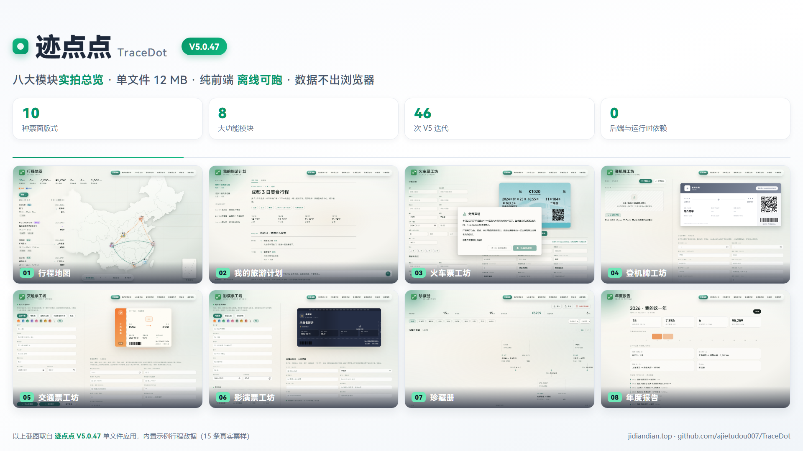
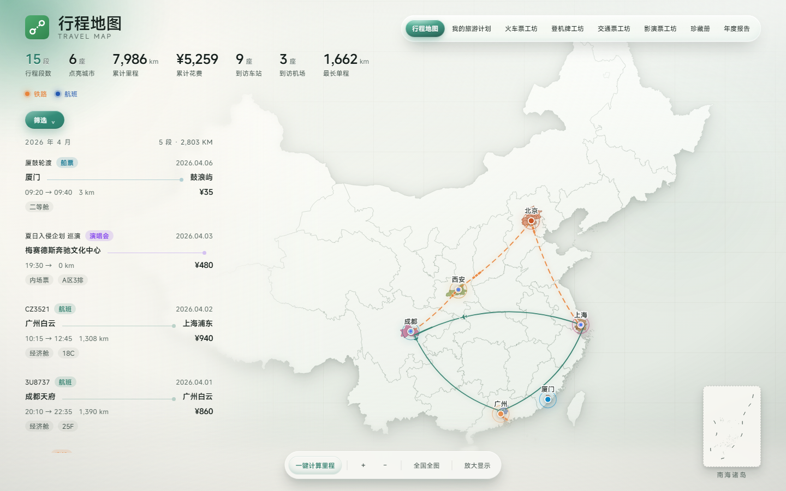
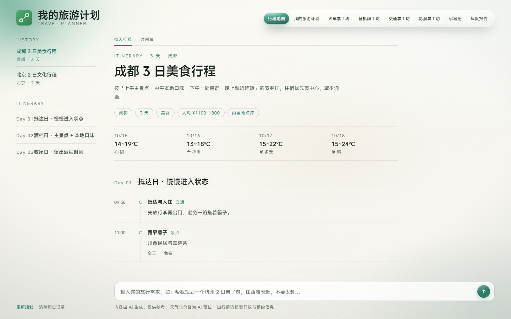
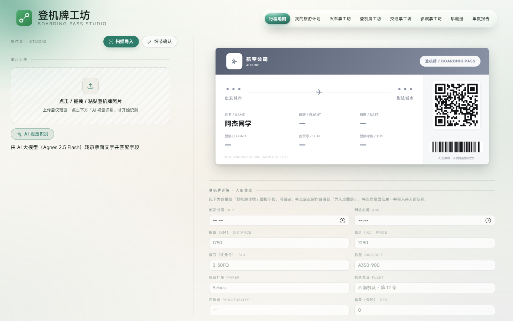
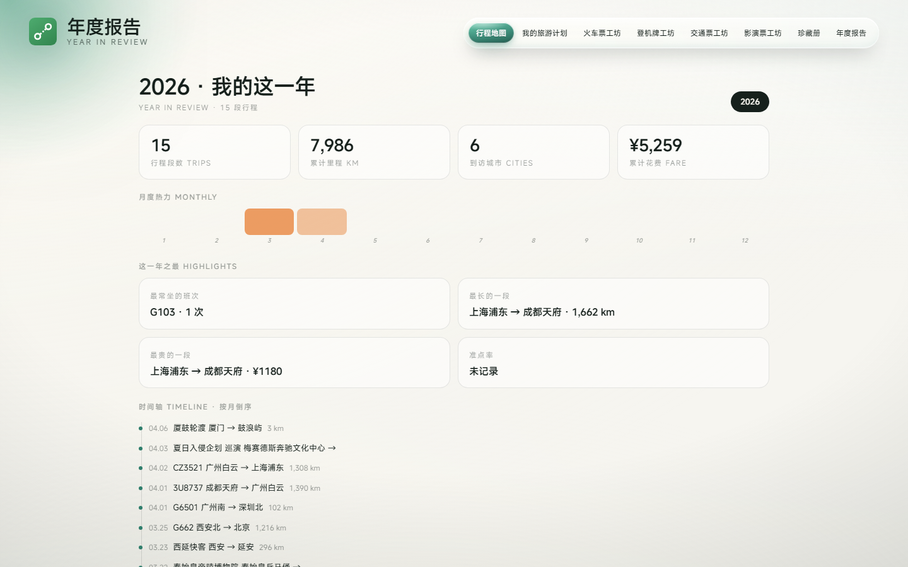

<div align="center">


# 🧳 迹点点 · TraceDot

**把每一张票根，画成一张属于你的中国地图。**


一款集成式「旅行纪念票根工作室」：**十种票面**在一处制作、收藏、绘制成地图、串成旅行编年史。
纯前端单文件 HTML，约 12 MB，双击即用、断网可用、数据不出浏览器。

[🌐 官方网站](https://jidiandian.top) ·
[📖 更新日志](CHANGELOG.md) ·
[🖼 模块总览图](docs/screenshots/overview-16x9.png) ·
[⬇ 下载应用](release/TraceDot-V5.1.3.html)

</div>

---

> **⚠️ 免责声明**
> 本项目仅供 **个人纪念与娱乐创作** 使用（收藏票根、短视频道具、手账素材、同人创作等）。
> 与中国国家铁路集团（12306）、各航空公司、文旅机构均无任何隶属或合作关系。
> **严禁**将生成的票面用于报销、退票、逃票、诈骗或其他任何违法违规用途，由此产生的一切后果由使用者自行承担。

---

## 📸 界面实拍

<div align="center">

<br><sub>八大模块实拍总览（16:9）· 内置 15 条示例行程数据</sub>
</div>

<details>
<summary><b>展开：八大模块逐张大图</b></summary>

<table>
  <tr>
    <td align="center" width="50%">
      <br>
      <b>01 · 行程地图</b><br>
      <sub>铁路实线弧 / 航班航路与飞机标记 / 到访城市点亮 / 距离·时长·费用榜单</sub>
    </td>
    <td align="center" width="50%">
      <br>
      <b>02 · 我的旅游计划</b><br>
      <sub>对话式 AI 规划 / 七步实时进度 / 按天行程与时间轴 / 行李清单</sub>
    </td>
  </tr>
  <tr>
    <td align="center">
      <br>
      <b>03 · 火车票工坊</b><br>
      <sub>12306 风格票根 / 六款底图 / 18 项细节精修 / PDF 导入 / 拍照 OCR</sub>
    </td>
    <td align="center">
      <br>
      <b>04 · 登机牌工坊</b><br>
      <sub>全球机场航司联想 / PDF417 真码制 / 扫描件 AI 识别回填</sub>
    </td>
  </tr>
  <tr>
    <td align="center">
      <br>
      <b>05 · 交通票工坊</b><br>
      <sub>公交 / 地铁 / 出租车 / 长途客运 / 船票，字段随票种自适应</sub>
    </td>
    <td align="center">
      <br>
      <b>06 · 影演票工坊</b><br>
      <sub>电影票 / 景区门票 / 演唱会票 / 海报自动匹配 / 4A·5A 景区联想</sub>
    </td>
  </tr>
  <tr>
    <td align="center">
      <br>
      <b>07 · 珍藏册</b><br>
      <sub>行程编年史时间轴 / 票种与年份筛选 / 批量导出</sub>
    </td>
    <td align="center">
      <br>
      <b>08 · 年度报告</b><br>
      <sub>年度大数字 / 12 格月度热力 / 之最榜单 / 准点率</sub>
    </td>
  </tr>
</table>

</details>

---

## 🧭 八大模块

| # | 模块 | 说明 |
|---|------|------|
| 01 | **行程地图** | 收藏的每张票自动绘制到自绘中国底图上：铁路实线弧、航班航路与飞机标记、到访城市点亮、榜单统计（距离 / 时长 / 费用）；添加行程支持即时预览真实票面 |
| 02 | **我的旅游计划** | 对话式 AI 行程规划：七步实时进度 + 思考面板，查询真实景点 / 酒店 / 美食 / 天气，按天生成行程卡与时间轴、行李清单，支持多轮追问 |
| 03 | **火车票工坊** | 12306 风格票根编辑器：六款底图、正反面制作、18 项细节精修、行程 PDF 智能导入、纸质票拍照 OCR；二维码自指本票信息 |
| 04 | **登机牌工坊** | 全球机场 / 航司数据库联想，条带码为**真 PDF417**、内容用 BCBP、与二维码同源可回扫；扫描件 AI 识别回填 |
| 05 | **交通票工坊** | 公交、地铁、出租车发票、长途客运、**船票**五种票面差异化版式，**入册字段随票种自动切换** |
| 06 | **影演票工坊** | 电影票、景区门票、演唱会票：配色自定义、海报 / 景区图自动匹配与自定义取景、全国 4A/5A 景区联想 |
| 07 | **珍藏册** | 行程时间轴：所有票面按出行时间串成旅行编年史，票种 / 年份筛选，一键导入 / 导出 / 批量导出 |
| 08 | **年度报告** 🆕 | 第 8 个视图：年度大数字、12 格月度热力、之最榜单、准点率统计 |

---

## ✨ V5 带来了什么

V5.0.1 → V5.1.5 共 **53 次迭代**，六个阶段：打底（性能与报错）→ 工坊成形 → 打磨 → 数据与地图 → 收口 → 次版本（数据契约变更 + 激活码门禁 + 六处修复与地图性能 + 航司 Logo 与地图标反修复）。
体积从 12.60 MB 收敛到 **12.24 MB**（−2.8%）。

- **🆕 年度报告**：第 8 个模块，年度大数字 + 月度热力 + 之最榜单 + 准点率
- **🔒 数据不再丢**：账本从 localStorage 迁到 **IndexedDB**（内存缓存 + IDB 主存 + 镜像三层），写入带时间戳仲裁，导入前自动快照、**一键回滚且回滚本身可撤销**
- **🎫 票面码制做真**：登机牌条带 Code128 → **PDF417**，火车票二维码从固定指向 12306 改为"指向这张票自己"
- **📥 老备份能导进来了**：通用解析器认 V4 / 手机端导出的嵌套 JSON 字符串格式，旧票面草稿自动迁移
- **🗺 地图更准**：直辖市按省域整片点亮、票种点一城一点（悬停看明细）、铁路虚线流动与航班流光
- **⌨️ 粘贴即录入**：短信 / 邮件正文直接粘贴，自动解析成行程
- **🛡 安全加固**：修复年度报告存储型 XSS、导入加 30MB / 5000 条上限、补充三条低风险 CSP、联网 OCR 明确提示
- **🪟 液态玻璃导航**：右上角胶囊改为四层玻璃质感，选中项为透光绿玻璃珠
- **⚡ 弱显卡不再卡**（V5.0.48）：自适应性能模式按实测帧时间对比屏幕刷新率自动降级，只关大面积毛玻璃与装饰动画；桌面端同时打开 GPU 光栅化、忽略显卡黑名单，Intel 核显机器不再退回软件合成
- **🗺 车站库扩容**（V5.1.0）：`STATION_XY` 14 → **3267** 站（12306 现役客运站 99.8%），机场表换 OurAirports；足迹统计带分母（2/369 座城市、1/33 个省份）、线路详情给出历时 / 均速 / 单价、年份图例、A4 打印模板
- **🔐 激活码门禁**（V5.1.1）：首次打开需输入激活码，通过一次后本机记住、之后直接进入；未通过时应用整体不启动。**网页版与桌面版同一套门禁**，校验在本机完成，不联网、不上传任何信息
- **🛠 六处问题修复 + 地图性能**（V5.1.2）：AI 设置弹窗关不掉、三个工坊票面与入册信息分两层滚动、香港西九龙站错位、重庆站名、香港城市不点亮、站点拼音，一次修完；地图标签改用 `transform` 缩放、屏幕矩形缓存 120ms、流光动画与 viewBox 写入去抖，拖动与缩放更顺滑
- **🛠 航司 Logo 与地图标反修复**（V5.1.3）：登机牌所选航司与票面 Logo 不再串票（采样带上 `airline`、预览缓存 `pv1 → pv2` 作废旧图）；行程地图出发 / 到达不再标反（名称与三字码相距超 300 km 以名称为准）、同名车站按「站名 + 空/铁」分开、地名匹配取最长键
- **🗺 地图城市归属全面纠正 + 缩放卡顿治理**（V5.1.4）：新增构建期「站点 → 城市」显式映射表 `JDD_STATION_CITY`（**3267 站**，由 12306 所属城市 + 底图市级轮廓「点在多边形内」判定生成），城市匹配由子串改为前缀锚定 —— 根治「昆山南」点亮西藏山南、「大兴」点亮大兴安岭这类跨省误配；城市坐标补 54 城、吸附容差 130 km → 65 km，偏远小站不再「有点不亮」；缩放/拖拽期摘除 SVG 实时滤镜（每帧重栅格化是卡顿主因）、城市与站点改父级整组 `transform` 补偿、绘图加数据签名跳过重复重建；编辑器补「出发/到达城市 + 三字码」四字段；逐站复核修正 21 处城市归属与 2 处坐标错位（磨丁、冠豸山南）
- **🐛 放大后站名变巨大修复 + 桌面端更新进度条**（V5.1.5）：V5.1.4 为压缩 DOM 写入把标记补偿改成了父级 `transform`，但写的是 CSS `style.transform` —— CSS 的 `translate()` 必须带单位，`translate(918,430)` 属于无效声明会被浏览器静默丢弃，于是整组补偿从未生效，放大后机场 / 火车站名跟着地图一起放大。改用 SVG 原生 `transform` 属性后，放大 21.9 倍站名仍 15 px、圆点仍 5.7 px；桌面端内容更新（12 MB HTML 热更新）新增无边框进度窗与任务栏 / Dock 进度，下载不再「静默等待」，同时修掉重定向 `Location` 为相对路径报 `Invalid URL`、旧流异步 `unlink` 删掉新 `.part` 导致 `ENOENT` 两处隐患

完整记录见 [CHANGELOG.md](CHANGELOG.md)。

---

## 🚀 快速开始

### 方式一 · 直接打开（推荐）

下载 [`release/TraceDot-V5.1.3.html`](release/TraceDot-V5.1.3.html)，用现代浏览器双击打开即可。
**零安装、零依赖、断网可用。**

### 方式二 · 在线使用

- 官网：<https://jidiandian.top>
- 备用线路：<https://ajietudou007.github.io/TraceDot/website/>
- 直接进应用：<https://jidiandian.top/release/TraceDot-V5.1.3.html>

### 方式三 · 桌面端（Windows 安装包）

从 [Releases](https://github.com/ajietudou007/TraceDot/releases) 下载对应平台的安装包：

| 平台 | 文件 |
|------|------|
| Windows（x64） | `TraceDot-Setup-5.1.5-x64.exe`（NSIS，支持自选安装目录与桌面快捷方式） |
| macOS（Apple Silicon） | `TraceDot-5.1.5-arm64.dmg` |
| macOS（Intel） | `TraceDot-5.1.5-x64.dmg` |

安装后即为独立原生窗口（内嵌同一份单文件应用，支持 `electron-updater` 自动检查更新）。
**Windows 安装包随 Release 提供；macOS 的 dmg / zip 由 GitHub Actions（macos-latest）自动构建并附在 Release 里。**

### 方式四 · 本地服务

```bash
python3 -m http.server 8080
# 打开 http://127.0.0.1:8080
```

---

## 🛠 开发 · 桌面端打包

应用本体是**零构建**的单文件 HTML，日常改 `release/` 里的那一个文件即可。
只有**桌面端**需要 Node 工具链。

```bash
cd desktop
npm install              # electron + electron-builder
npm start                # 本地开发窗口（会把 ../release/TraceDot-V5.1.3.html 拷进 app/index.html）
npm run dist:win         # 产出 Windows NSIS 安装包 → desktop/dist_electron/
npm run dist:mac         # 产出 macOS dmg + zip
```

| 命令 | 作用 |
|---|---|
| `npm run prep` | 把 `../release/TraceDot-V5.1.3.html` 复制为 `desktop/app/index.html` |
| `npm start` | `prep` + `electron .`（开发模式，不触发自动更新） |
| `npm run dist:win` | `prep` + `electron-builder --win`（NSIS，x64） |
| `npm run dist:mac` | `prep` + `electron-builder --mac`（dmg + zip，arm64 / x64） |
| `npm run dist` | 同时打 Windows 与 macOS |

> ⚠️ `npm run dist:mac` **只能在 macOS 上执行**——electron-builder 会在其他平台直接报
> `Build for macOS is supported only on macOS`。Windows 上只能产出 `--win` 产物。

**CI 自动构建**：推送 `v*` 标签（或在 Actions 里手动触发）即运行 `.github/workflows/release.yml`，
两个 job 并行产出全部桌面端产物并附到该 Release：

| Job | 运行器 | 命令 | 产物 |
|---|---|---|---|
| `build-win` | `windows-latest` | `electron-builder --win` | `TraceDot-Setup-<ver>-x64.exe`、`latest.yml` |
| `build-mac` | `macos-latest` | `electron-builder --mac` | `*.dmg`（arm64 / x64）、`*.zip`、`latest-mac.yml` |

**升级版本时改四处**（按顺序）：
1. `CHANGELOG.md` 顶部先加一条 `## [Vx.y.z] - YYYY-MM-DD` —— 应用内左上角的「有新版本」提示就是从这份日志里取最大的 `Vx.y.z` 与本地 `APP_VER` 比较，标题格式不对或没写，官网就不会提示；
2. 应用文件里的 `APP_VER`（文件末尾「新版本检测」脚本）与 `<title>` 的版本号；
3. `desktop/package.json` 的 `version` 与 `prep` 脚本里的文件名；
4. `release/` 中的应用文件。

---

## 📁 项目结构

```text
TraceDot/
├── README.md                     # 本文件
├── CHANGELOG.md                  # 全量版本日志（前身项目 V4.0 → 迹点点 V5.1.2）
├── CREDITS.md                    # 开源项目 / 数据源 / 云服务 / 工具链致谢
├── LICENSE                       # MIT（含第三方组件许可声明）
├── CNAME                         # jidiandian.top
├── index.html                    # GitHub Pages 入口（跳转官网）
├── website/
│   ├── index.html                # 官方网站首页（苹果风格，纯静态单页）
│   └── changelog.html            # 官方网站 · 更新日志页
├── release/
│   └── TraceDot-V5.1.3.html     # 应用本体（单文件，含全部样式 / 脚本 / 内嵌资源）
├── docs/
│   ├── FEATURES.md               # 模块功能详表
│   └── screenshots/              # 演示截图（含 16:9 头图与八模块总览图）
├── desktop/
│   ├── main.js                   # Electron 主进程（窗口 / 菜单 / 自动更新）
│   ├── package.json              # 打包配置（electron-builder）
│   └── build/                    # 打包图标（icon.ico / icon.icns）
└── .github/workflows/
    └── release.yml               # 打标签自动构建 Windows 安装包
```

---

## 🔧 技术实现

- **技术栈**：原生 HTML / CSS / JavaScript，无框架、无构建步骤、无运行时依赖
- **单文件多模块架构**：外壳（Shell）+ 八个功能模块。模块 HTML 以 Base64/gzip 内嵌为 `<script type="text/plain">` 载荷，运行时解码并注入隐藏 iframe；模块间通过 `postMessage` 总线通信（独立消息标记）
- **载荷注册表**（V5.0.37）：`JDD_PLUGINS` 一张表生成模块表与全部 `jddBootXxx` 包装，新增模块只改一处
- **共享资源去重**：跨模块重复的内联资源（html2canvas、机场库 / 航司库、统一 UI 样式）抽取为 `shared-*` 块，模块内以占位符引用，注入前还原
- **按需解压**：pdf.js 等大库改成点到才解压（启动少解析 1.37 MB JS）；base85 解码用定长 `Uint8Array`，峰值内存 20MB → 5MB
- **存储三层**：`jddStore` = 内存缓存 + IndexedDB 主存 + localStorage 镜像，双方带写入时间戳、启动时谁新用谁；镜像超 1.1MB 只存轻索引（冷热分层）
- **导出管线**：登机牌 / 交通票 / 影演票用内嵌 html2canvas 1.4.1（离屏克隆 + 2x 高清）；火车票走 Canvas 原生绘制直出；导出统一 1.5% 居中裁白边
- **地图绘制**：自绘 SVG 中国底图（无第三方地图库），贝塞尔弧线 + 图层控件 + 悬停明细；地点解析四级兜底（站名库 → 机场库 → 城市坐标库 → 模糊匹配）
- **桌面端**：Electron 33 + electron-builder，`nodeIntegration: false` / `sandbox: true` / `contextIsolation: true`，外链走系统浏览器

---

## 🔒 隐私说明

- 所有票面与行程数据默认**只保存在本机**（IndexedDB + localStorage），无任何统计、追踪或后端服务器
- 仅三类操作会经用户**明确确认后**联网：
  1. 识别引擎选择「联网引擎」（Agnes / OCR.space / 百度）时上传票面照片用于 OCR（已加提示）；
  2. 影演票工坊点击「自动匹配」时向 OMDb 查询电影海报；
  3. 旅游计划使用 AI 生成行程时调用大模型接口。
- 珍藏册数据支持 JSON / CSV / ICS 导入导出，导入前自动留快照，可一键回滚

---

## 🌐 浏览器兼容

| 浏览器 | 支持情况 |
|--------|----------|
| Chrome / Edge（Chromium） | ✅ 推荐最新版 |
| Safari | ✅ 最新版 |
| Firefox | ✅ 最新版 |
| 夸克 / UC 等移动内核 | ✅ 已做触控与下载兼容 |
| Electron 33（桌面端） | ✅ Windows / macOS |

需要支持 Canvas 2D、`FileReader` / `DataTransfer`、`DecompressionStream` 的现代浏览器。

---

## 📋 版本日志

完整修改记录见 [CHANGELOG.md](CHANGELOG.md)——涵盖前身项目「12306 火车票票根编辑器」V4.0 → V6.2.4、
迹点点 V2.x / V3.0.0 → V4.1.8，以及 **V5.0.1 → V5.1.3 全部 51 次迭代**。

---

## 🤝 参与贡献

欢迎 Issue 与 PR！

1. Fork 本仓库并新建分支（`git checkout -b feature/your-feature`）
2. 修改 `release/` 中的单文件应用（**保持单文件架构，勿引入构建步骤或外部运行时依赖**）
3. 提交变更（`git commit -m "feat: xxx"`）并发起 Pull Request
4. 提交前请自测：明暗双主题、八大模块互转、票面导出与珍藏册同步均应正常

---

## 📄 许可证

本项目基于 [MIT License](LICENSE) 开源；前身项目「12306 火车票票根编辑器」同为 MIT。
第三方内嵌组件的许可声明见 [LICENSE](LICENSE) 附录与 [CREDITS.md](CREDITS.md)。

## 🙏 致谢

- [12306 火车票票根编辑器](https://github.com/ajietudou007/12306-train-ticket-editor) —— 迹点点的前身与火车票工坊内核
- [pdf.js](https://github.com/mozilla/pdf.js) · [html2canvas](https://html2canvas.hertzen.com) · [bwip-js](https://github.com/metafloor/bwip-js) · [qrcode-generator](http://www.d-project.com/) · [LZ-String](https://github.com/pieroxy/lz-string) · [PaddleOCR](https://github.com/PaddlePaddle/PaddleOCR) · [Tesseract.js](https://github.com/naptha/tesseract.js) · [Electron](https://www.electronjs.org/)

### V5.1.0 完整致谢

**开源软件库**（Apache-2.0）

- [pdf.js](https://github.com/mozilla/pdf.js) 3.11.174 —— PDF 解析与渲染 · 贡献者：Snuffleupagus、timvandermeij、calixteman、yurydelendik、brendandahl 等
- [Tesseract.js](https://github.com/naptha/tesseract.js) 5.0.4 —— 浏览器端 OCR · 贡献者：jeromewu、bijection、Balearica、antimatter15 等

**开源数据库**

- © [OpenStreetMap](https://www.openstreetmap.org/copyright) contributors（ODbL 1.0）—— 车站坐标主源（2,870 / 3,267 站）
- [China-Railway-Station-Database](https://github.com/undef-i/China-Railway-Station-Database)（CC0-1.0）—— 车站坐标补缺（394 / 3,267 站）· undef-i
- [OurAirports](https://ourairports.com/data/)（Unlicense）—— 机场坐标数据源 · David Megginson

**字体**

- [MiSans（小米兰亭）](https://hyperos.mi.com/font/)（《MiSans 字体知识产权许可协议》）—— 全站显示字体，内嵌子集（GB2312 + ASCII，400 / 600）· 小米主导，联合蒙纳（Monotype）、汉仪（Hanyi）制作
- 系统回退字体：PingFang SC（Apple）、Microsoft YaHei（Microsoft）· 无需署名

完整名单见 [CREDITS.md](CREDITS.md)。
